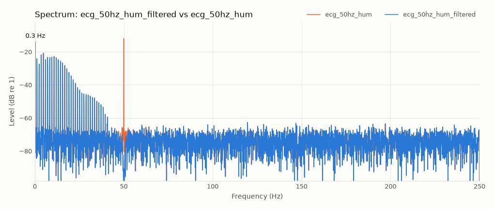
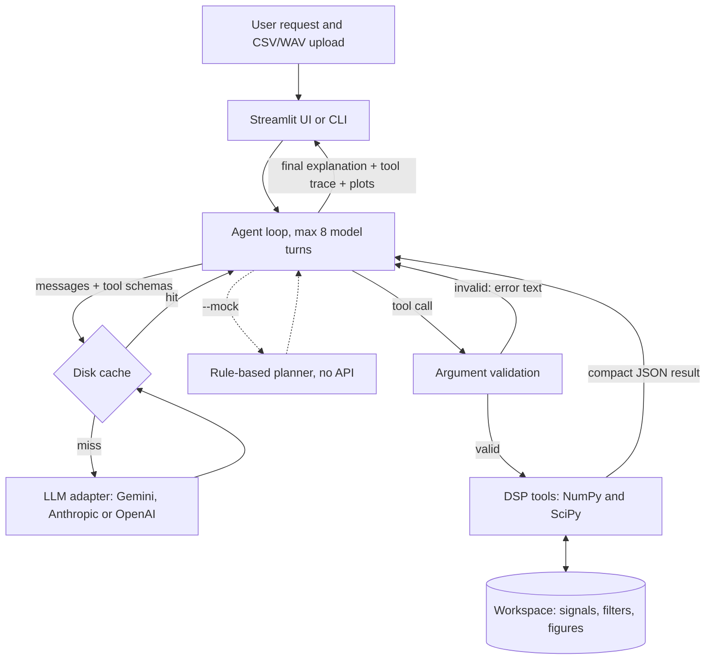
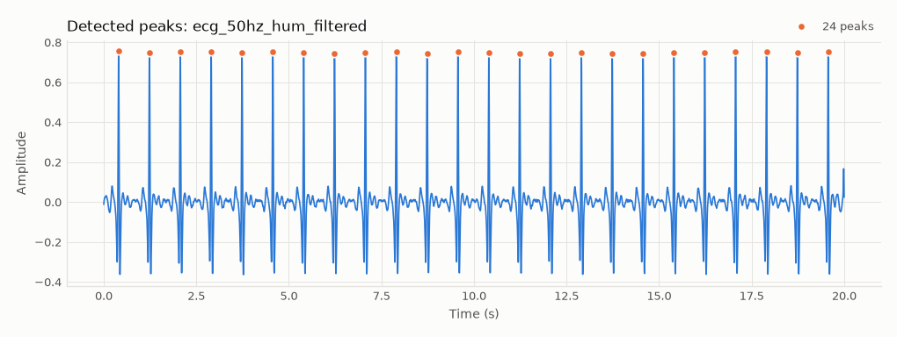
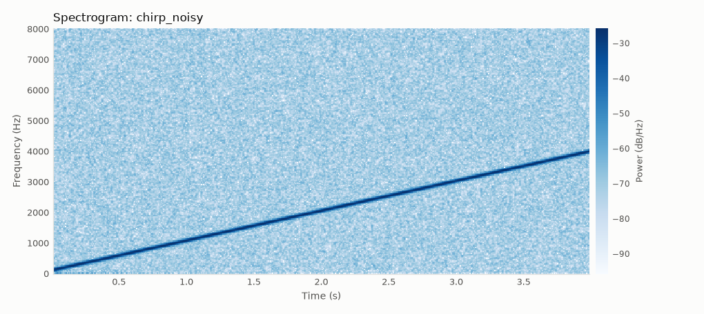

# DSP Copilot

An LLM agent that does signal processing on your CSV or WAV files. Ask in plain English, for example *"remove the 50 Hz hum and show the spectrum"*. The agent chooses the tools, runs them, plots the results and explains what it did. Every tool call is shown, so the work can be checked.



## Problem

Routine signal analysis needs specialist knowledge: which filter to use, how to set it, and how to tell whether it worked. A general chatbot can talk about this, but it can't touch your data, and it may invent numbers.

## Approach

The language model plans and explains. It does no maths.

- **Typed tools only.** The model can call 8 fixed tools. It never writes or runs code.
- **Numbers come from NumPy and SciPy.** The model is told to report only tool results.
- **Arguments are checked first.** A cutoff above Nyquist or an unknown signal name goes back to the model as an error it can correct.
- **Signals stay local.** Tools refer to signals by name. The model sees summaries and results, never the samples.
- **Everything is visible.** The UI lists each call with its arguments, result and plots.

| Tool | What it does |
|---|---|
| `describe_signal` | Sample rate, Nyquist, duration, RMS, peak, mean |
| `plot_signal` | Time-domain plot, with optional zoom |
| `compute_fft` | Amplitude spectrum, strongest peaks, before/after overlay, level at chosen frequencies |
| `compute_spectrogram` | How frequency content changes over time |
| `design_filter` | FIR, Butterworth, Chebyshev I or notch, with a frequency response plot |
| `apply_filter` | Zero-phase or causal filtering. Creates a new signal and keeps the original |
| `detect_peaks` | Time or frequency domain, including rate per minute |
| `compute_snr` | Against a clean reference, or by narrow band versus everything else |

## Architecture



## Results

Six example requests were run against **`gemini-3.5-flash-lite`**, using synthetic signals with known ground truth. The checks measure the signals the agent actually produced, so they don't rely on what it says it did.

**6 of 6 passed**, using 19 model turns and 13 tool calls, with no tool errors.

| Request | Tools the agent chose | Measured result | Pass condition |
|---|---|---|---|
| Remove the 50 Hz hum and show the spectrum | `design_filter`, `apply_filter`, `compute_fft` | 50 Hz band −54.0 dB, 10 Hz band −0.00 dB | ≤ −20 dB, and 10 Hz within ±1 dB |
| What are the dominant frequencies? | `compute_fft` | Found 440, 1000 and 3000 Hz | Each within ±2 Hz |
| Show me a spectrogram of the chirp | `compute_spectrogram` | Sweep 125 → 3968.8 Hz (truth 100 → 4000) | Within ±100 Hz |
| Low-pass at 1 kHz, 4th-order Butterworth, compare | `design_filter`, `apply_filter`, `compute_fft` | 3 kHz −84.2 dB, 440 Hz −0.01 dB, correct design | ≤ −30 dB, 440 Hz within ±1 dB, states the gain applied |
| What is the SNR of the noisy tone? | `compute_snr` | 10.0 dB (truth 10.002 dB) | Within ±1 dB |
| Detect the R-peaks and estimate the heart rate | `compute_fft`, `design_filter`, `apply_filter`, `detect_peaks` | 72.0 bpm from 24 peaks (truth 72) | Within ±3 bpm |

The agent chose the 5 to 30 Hz band-pass before peak detection by itself, following its system prompt. That step matters: on the raw ECG, peak detection reports about 128 bpm because it also counts T-waves. The tool now adds a warning when peak spacing is that irregular.





Also run:

- **Mock mode:** 6 of 6, with 0 API calls. This covers the tools and the agent loop, but the planning is done by keyword rules, so it says nothing about model quality.
- **Test suite:** 46 tests pass. They cover DSP accuracy, input validation, error recovery, the step limit, caching, and the Streamlit app in mock mode.

A summary table is in [results/eval_live.md](results/eval_live.md). Each answer and tool call is in [results/eval_live.json](results/eval_live.json).

### What reading the answers found

The first live run also scored 6 of 6, yet two answers were wrong. The checks looked at the signals but not the explanations. Reading the answers by hand exposed these problems:

| Problem found | Cause | Fix |
|---|---|---|
| Said −3 dB at the cutoff when −6 dB was applied | The tool reported only the single-pass design gain, but zero-phase filtering applies the filter twice | `apply_filter` now reports the gain actually applied, and the check requires it in the answer |
| Said the chirp starts at 312.5 Hz (truth 100 Hz) | The tool took a median over the first 10% of the signal, and the check only tested that frequency rose | The tool now uses the first few time slices, and the check compares with the truth |
| Valid `max_freq_hz=250` rejected | A sample rate derived from a CSV time column carried floating-point error (Nyquist 249.99999999999977) | The derived rate is now rounded |
| Claimed −568 dB of attenuation | A rounding artifact of the notch's theoretical null | Depths beyond −120 dB are reported as "below -120" |

All four traced back to how our tools reported results or handled input, so the fixes went there, not into the prompt. The lesson for this kind of system: passing checks on the output doesn't validate the explanation.

## How to run

Requires Python 3.12.

```bash
python -m venv .venv
.venv\Scripts\activate            # Linux/macOS: source .venv/bin/activate
pip install -r requirements.txt
python scripts/make_samples.py    # regenerates the synthetic signals
```

No API key is needed for these:

```bash
streamlit run app.py              # mock mode is on by default
python cli.py samples/ecg_50hz_hum.csv "remove the 50 Hz hum and show the spectrum" --mock
python evaluate.py --mock
pytest
```

To use a real model, copy `.env.example` to `.env` and add a key. Set `LLM_PROVIDER` to `gemini` (the default), `anthropic` or `openai`, and `LLM_MODEL` to override the default model. In the app, turn off the mock toggle.

```bash
python cli.py samples/tone_noisy.wav samples/tone_clean.wav "what is the SNR of tone_noisy?"
python evaluate.py                # replays the committed cache: 0 paid calls
```

Every model reply is cached in `cache/llm/`, so repeating a conversation costs nothing. A changed prompt or tool result makes a new cache key and new paid calls.

## Limitations

- **Small evaluation.** Six requests, one run each, all on clean synthetic signals. It shows the system works end to end, not how reliable it is on real recordings or unusual wording.
- **Explanations aren't machine-checked.** The checks cover signals and a few key statements. The model's wording can still slip: the passing low-pass answer says tones "at or below 1 kHz" passed unattenuated, in the same sentence that correctly gives −6.02 dB at 1 kHz. Trust the tool trace over the prose.
- **Only Gemini has been tested live.** The Anthropic and OpenAI adapters are implemented but have never been run against those APIs.
- **The live model hasn't been used through the Streamlit UI.** The app was tested in mock mode. Live runs used `evaluate.py`.
- **Two numbers for hum removal.** The agent reports −92 dB, the level at the exact 50 Hz bin. The evaluation's −54.0 dB is stricter: it measures all power within ±1 Hz, including the notch's transient at the start and end of the signal.
- **Filter edge effects.** A Q=30 notch rings for about 0.2 s at 50 Hz, visible at the start of the filtered ECG. Discard the edges of short recordings.
- **Input assumptions.** CSV data is assumed to be evenly sampled (the rate comes from the median spacing). Stereo WAV is mixed to mono. Files are limited to 5 million samples.
- **Not a medical device.** The ECG here is synthetic and the heart-rate tool is a demonstration. It must not be used for clinical purposes.
